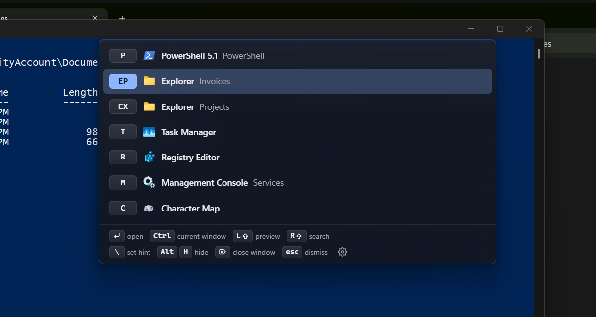
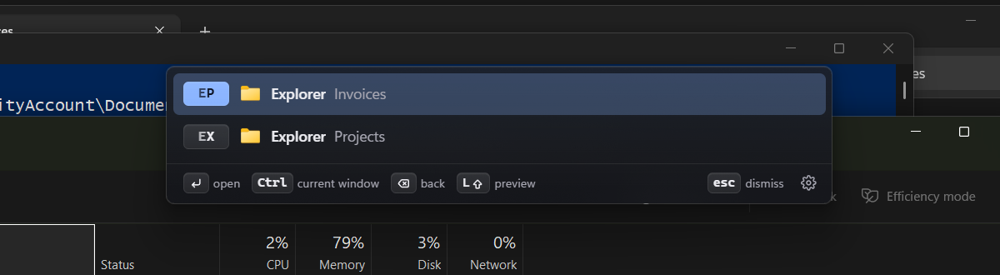
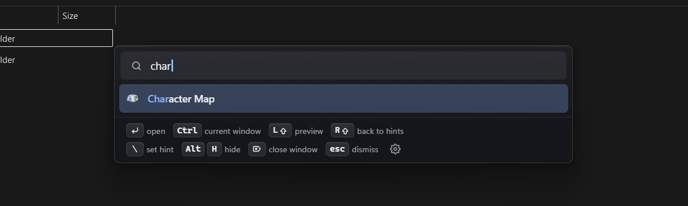
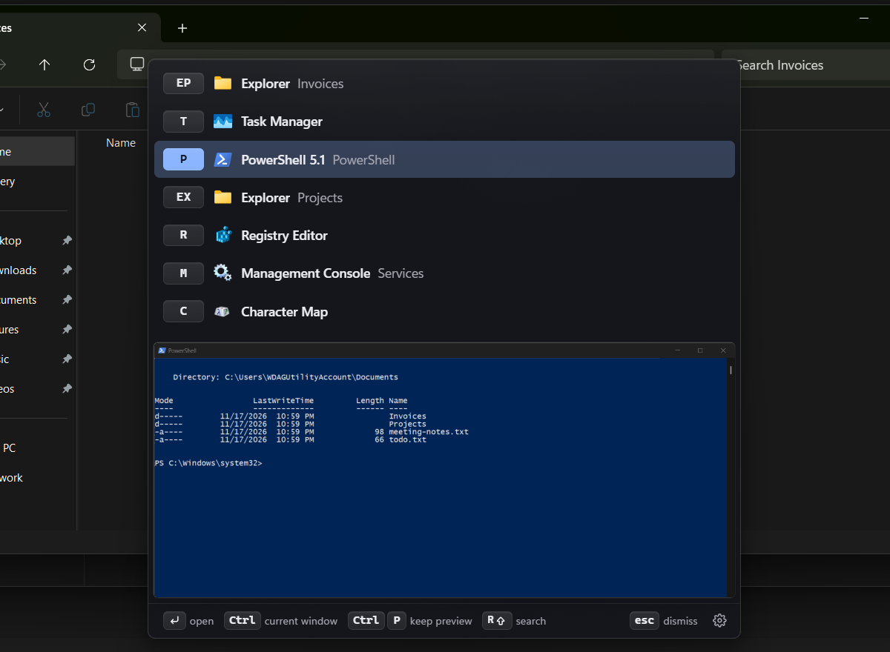

# keytab

[](https://github.com/HayzDev/keytab/releases/latest)
[](https://github.com/HayzDev/keytab/actions/workflows/ci.yml)
[](LICENSE)

A keyboard-first Alt-Tab replacement (Rust + Tauri 2). Open it, type a window's letter(s), and that window gets focus.
Inspired by [Adam Basis](https://www.youtube.com/@AdamBasis)'s alt-tab videos.

<p align="center">
  
</p>

Press **Right Alt**, type the letters next to a window, done. No cycling, no hunting through thumbnails.

| | |
|---|---|
| <br>**Type to narrow.** Windows of the same app get hints like `EP` and `EX`; one letter filters, the next picks. | <br>**Fuzzy search.** Right Alt + Right Shift, then type any part of an app name or window title. |
| <br>**Live previews.** Hold Left Shift to see the selected window before switching. | **Also:** custom hints per window or per app, close or hide windows from the switcher, mouse support, light/dark themes, start at login, and automatic updates. |

<sub>Screenshots were recorded in a clean Windows Sandbox with the scripts in [scripts/demo](scripts/demo).</sub>

## Install

### Windows 10 / 11

**[⬇ Download keytab-setup.exe](https://github.com/HayzDev/keytab/releases/latest/download/keytab-setup.exe)** and run it. No admin rights needed.

Or paste this into PowerShell:

```powershell
irm https://raw.githubusercontent.com/HayzDev/keytab/main/install.ps1 | iex
```

keytab then runs in the tray and starts at login. To turn that off, right-click the tray icon and untick **Start at login**.
Press **Right Alt** to switch windows. To uninstall, use *Settings → Apps → keytab*.

> The installer isn't code-signed yet, so Windows SmartScreen may say "Windows protected your PC".
> Click **More info → Run anyway**.

### Linux (niri)

```sh
curl -fsSL https://raw.githubusercontent.com/HayzDev/keytab/main/install.sh | sh
```

This installs `keytab` and `keytabctl` to `~/.local/bin`, adds the keybinds to your niri config, and starts keytab.
An existing `~/.config/niri/keytab.kdl` is never overwritten (by the installer or by in-app updates), so custom keybinds survive.
Press **Alt+Tab** or **Mod+Tab** (add Shift for search). The prebuilt binary is built on Fedora 44 (x86_64) and needs these runtime packages:

```sh
sudo dnf install webkit2gtk4.1 gtk3 gtk-layer-shell python3-gobject gstreamer1-plugins-base pipewire-gstreamer
```

On other distros, or if the binary won't start, [build from source](#build).

All downloads are on the [Releases page](https://github.com/HayzDev/keytab/releases).

## Keys

| Key | Does |
|---|---|
| **Right Alt** (Windows) / your niri bind | open / close |
| hold Right Alt + **Right Shift** / `keytab --search` | open in fuzzy search |
| hold Right Alt + **Enter** (Windows) | like Alt+Tab: selects the previous window, each Enter goes further back, Shift+Enter goes forward, releasing Right Alt switches |
| letters | focus the window with that hint (two letters when first letters clash) |
| **Right Shift** (while open) | switch to search mode; press again to go back to hints |
| `/` | switch from hints to search mode |
| hold **Left Shift** | preview the selected window; in hint mode, release to focus a fully typed hint. Works in search too |
| **Ctrl** | select the window active before opening Keytab, if it is in the results |
| **Ctrl+P** | keep previews on without holding Shift (until pressed again or keytab restarts) |
| Backspace | undo a typed letter / query character |
| ↑ ↓ or **Alt+K / Alt+J** | move the selection in either mode |
| Enter | focus the selected window in either mode |
| Delete | ask to close the selected window; press again to confirm. In the hint dialog: reset to default |
| `\` | set a hint for this one window (lives as long as the window) |
| `\|` | set a hint for every window of this app (saved to disk) |
| **Alt+H** | hide the selected window from keytab for good (see below) |
| Esc / CapsLock | close or go back |

Partial hint matches prioritize other windows ahead of the window that was active
when Keytab opened. Ctrl can still select that active window explicitly.

Hints are prefix-free. Auto hints use the app's own letters (chrome + code → `ch`, `co`). User hints win, and the auto hints rearrange around them.
If several windows of one app share an app hint `x`, they become `x1`, `x2`, …
A per-window hint can extend its own app's hint with a letter, such as `bs` for
one window of an app with hint `b`. The other windows use numbered hints even
if only one of them remains, so `b` never conflicts with `bs`.

On Niri, per-window hints are saved immediately to `~/.config/keytab/window-hints.json`
and survive Keytab updates and restarts while that same window remains open.
Closed-window records are pruned on the next successful window-list refresh.
The cache is scoped to the Niri instance (boot, process start time, and socket),
so a new desktop session cannot inherit old window IDs. Window titles may change
without losing their hint. Windows per-window hints still remain in memory.

Hidden windows (Alt+H, or a row's hide button; Shift+click hides every window of the app) are kept in
`settings.json` under `hidden`, matched by app name and exact window title, case-insensitively. A window whose
title changes shows up again. Bring them back from Settings › Switcher › Hidden windows.

App hints are saved in `%APPDATA%\keytab\app-hints.json` on Windows and `~/.config/keytab/app-hints.json` on Linux. The file maps lowercase app name to hint.

### Mouse

The mouse has its own faint highlight and never moves the keyboard's selection, so opening keytab under a
resting pointer selects nothing. Click a row to switch to it.
Middle-click it to close the window. The hovered row also shows a tag button (set a hint; Shift+click
sets one for the whole app), a hide button (Shift+click hides the whole app) and a × button. Every key in the footer is clickable, the preview opens its
window when clicked, and the gear opens Settings. On Windows, clicks never take focus away
from the window you came from; on niri the overlay already holds keyboard focus while it is open.

### Settings and updates

Open Settings from the gear in the switcher, with `keytab --settings` (`keytabctl --settings` on Linux), or, on
Windows, by clicking the tray icon. It has: start at login, the open key, the theme (System, Dark, Light; it applies
to the switcher too), close confirmation, previews on by default, hidden windows, your saved app hints,
and updates. Settings are saved to `%APPDATA%\keytab\settings.json` on Windows and `~/.config/keytab/settings.json` on Linux.

On niri, two of those live in your niri config instead, which keytab reads but never edits:

- **Keybinds** replace the open-key choice. Settings lists every niri bind that runs `keytabctl` (for example an `F13`
  key sent by a keyboard remapper, or `Mod+Tab`) and the file it is in. Change them in that file.
- **Start at login** shows whether a `spawn-at-startup` line starts keytab, and where. The switch is read-only.

The System theme follows the desktop's color scheme through the XDG settings portal
(`org.freedesktop.appearance color-scheme`); with no preference it is dark.

**Updates** come from GitHub Releases on one of two channels. **Stable** gets tagged releases. **Nightly** is the
`nightly` prerelease, rebuilt from every push to `main`. With *Update automatically* on (the default), keytab
checks for an update about 10 seconds after it starts, waits until the switcher is closed, then installs the update
silently and restarts. *Check now* and *Update* in Settings do the same thing on demand. Debug builds never auto-update.

On Linux an update downloads `keytab-linux-x86_64.tar.gz` with `curl`, replaces only `keytab` and `keytabctl`
next to the running executable (staged, then renamed, so a failed update changes nothing), and restarts keytab.
Your niri config, including `keytab.kdl` and any custom keybinds, is never touched. Linux updates need the
x86_64 release binary in a folder you can write to (such as `~/.local/bin`). Builds from source (`cargo build`)
never update automatically; *Check now* still shows newer releases, and a build inside a cargo `target` folder
refuses to replace itself.

## Build

```sh
cargo run              # dev
cargo build --release  # target/release/keytab(.exe)
cargo test
```

No Node/npm needed to build or run. Linux uses native GTK widgets; Windows uses `ui/index.html`.

### Windows installer

```sh
npx @tauri-apps/cli@2 build   # target/release/bundle/nsis/keytab_<version>_x64-setup.exe
```

### Releasing

Bump `version` in `Cargo.toml`, commit, then push a matching tag:

```sh
git tag v0.2.0 && git push origin v0.2.0
```

The [Release workflow](.github/workflows/release.yml) builds the Windows installer and the Linux
archive and publishes them as a GitHub release. `keytab-setup.exe` and `keytab-linux-x86_64.tar.gz`
keep the same names every release, so the `releases/latest/download/...` links always work.

The same workflow runs on every push to `main` too. It replaces the `nightly` prerelease, and the release notes'
`Commit: <sha>` line tells the updater whether a nightly is new. Prereleases never become
`releases/latest`, so stable download links are unaffected.

### Fedora deps

```sh
sudo dnf install webkit2gtk4.1-devel openssl-devel librsvg2-devel gtk3-devel gtk-layer-shell-devel wayland-devel wayland-protocols-devel
sudo dnf install python3-gobject gstreamer1-plugins-base pipewire-gstreamer
sudo dnf group install c-development
```

## Linux / niri

Wayland has no global keyboard hook, so keytab works differently there:

1. A Niri keybind runs the lightweight `keytabctl --toggle` or `keytabctl --search`.
2. The helper sends the command to the resident process over D-Bus.
3. An already mapped, transparent GTK layer surface gains keyboard focus and renders
   the shared switcher state. Opening does not create another window or webview.

Install the binary and the supplied Niri configuration:

```sh
cargo build --release --locked
install -Dm755 target/release/keytab ~/.local/bin/keytab
install -Dm755 scripts/keytabctl ~/.local/bin/keytabctl
install -Dm644 niri.kdl ~/.config/niri/keytab.kdl
```

Add this line once to `~/.config/niri/config.kdl`:

```kdl
include "keytab.kdl"
```

Then reload and start Keytab for the current session:

```sh
niri validate
niri msg action load-config-file
~/.local/bin/keytab
```

**Win+Tab** or **Alt+Tab** opens hints; **Win+Shift+Tab** or **Alt+Shift+Tab** opens fuzzy search. Keytab starts hidden
on future Niri logins. The overlay uses the `keytab` layer namespace and does not
appear in Niri's normal window list or trigger window tiling/open animations.
The panel has a translucent background, a thin lighter outline, and compositor
blur clipped to its rounded bounds. Blur requires compositor support for
`ext-background-effect-v1` (available on this device); GTK layer shell 0.9 or newer
is required. The supplied layer rule disables wallpaper-only (xray) blur for Keytab.
Escape, selecting a window, or clicking the transparent area dismisses it. The settings window is an ordinary
niri window with the same blurred glass when the compositor supports it, and an opaque card otherwise.

Previews are snapshots loaded asynchronously through Niri’s PipeWire interface.
They stay in memory and leave the clipboard untouched. Recent snapshots are reused
immediately; snapshots older than five seconds refresh in the background on the
next preview request. Only the selected window is captured, using a temporary
session and GPU scaling. Capture resolution follows the display scale, so enlarged
previews retain detail on HiDPI displays. One framed preview sits below the list in both modes.
In normal mode, hints wait for Shift release while previews are shown; a
fully typed hint opens on release. Shifted number-row symbols (`!` through `)`) count as
their digits in hints, so Shift+2 still enters `2`. Backspace widens the matches again. In search mode,
Left Shift only shows the selected preview; typing and Enter keep their normal behavior.
The native search field supports cursor movement, Shift selection, Ctrl+A,
Ctrl+Backspace/Ctrl+Delete, and clipboard shortcuts. Ctrl+P, Ctrl+Enter, and
Ctrl+\ or Ctrl+| remain Keytab commands. Bare Delete still asks to close a window.
The GTK renderer includes app icons, custom-hint colors, and a key-symbol footer showing the
actions available in the current state. The resident layer has an empty pointer
input region while hidden, including immediately after login.

Open settings with the gear in the switcher's footer or `keytabctl --settings`; you can bind that in your niri
config (`Mod+Comma { spawn "~/.local/bin/keytabctl" "--settings"; }`). Quit with `keytabctl --quit`
(there's no tray on Linux).

Window list, focus and close go through `niri msg --json windows` and `niri msg action focus-window|close-window --id N`.

### Status of the niri port

- Built and tested on Fedora 44 with Niri. The running compositor supplies
  `focus_timestamp`; older versions without it use focused-first, then Niri's order.
- Known gap vs Windows: the Windows version handles keys from the moment you press the hotkey. On Wayland, a key typed before the overlay has focus is lost.
- Known gap vs Windows: CapsLock still toggles caps on Wayland, because a focused app can't stop the compositor from seeing it.
- Known gap vs Windows: no tray icon, so Settings opens from the switcher's gear or `keytabctl --settings`.
- Known gap vs Windows: the open key and start-at-login are niri config (see Settings and updates), shown
  read-only in Settings. A held-modifier gesture like Windows' "hold Right Alt + Right Shift" isn't available:
  niri binds fire once per chord, so search has its own bind.
- Known gap vs Windows: previews are snapshots refreshed every few seconds, not live thumbnails.

## Layout / porting

### Windows look

- The overlay window is sized to the card (`layout` command) and gets an acrylic blur
  plus Windows 11 rounded corners.
- Apps show their real icon (`http://icon.localhost/<window id>`, from `WM_GETICON`)
  and a friendly name from the exe's version info ("Phone Link", not "PhoneExperienceHost").
- A trailing " - App" in titles is hidden, since the app name is already shown.
- Clicking outside the card closes it (low-level mouse hook).
- Debug builds take `--keys=^ab` to press keys after opening (`^` holds Shift), for screenshots.

### Windows previews

Holding Left Shift (Right Shift toggles search mode)
shows one large live preview of the selected window under the list; arrow keys change
it. It's a DWM thumbnail (`DwmRegisterThumbnail`) drawn over a box the webview lays out
and reports through the `layout` command, sized to the window's shape. A minimized
window shows its icon instead.
Shift is never swallowed by the hook, so the app behind just sees a bare Shift.

```
src/
  main.rs           Tauri wiring, commands, settings window, --toggle/--search/--settings/--quit
  settings.rs       settings.json (platform-neutral)
  updater.rs        GitHub Releases updates (Windows installer, Linux archive)
  switcher.rs       platform-neutral state machine (abstract `Key`s), fuzzy search, hint dialogs, saved hints
  keys.rs           `Win` model + prefix-free hint assignment (pure, tested)
  platform/mod.rs   the backend contract
  platform/win32.rs Windows: EnumWindows, low-level keyboard hook, no-activate overlay
  platform/niri.rs  Niri IPC and persistent layer surface
  platform/gtk_ui.rs native Linux UI and keyboard events
  platform/material.c Wayland compositor blur region
scripts/keytabctl    lightweight Linux D-Bus command client
scripts/thumbnail.py embedded one-shot PipeWire capture helper (Python/GStreamer)
ui/index.html       Windows switcher UI
ui/settings.html    settings window (both platforms)
```

To port to another platform or compositor:

1. Add `src/platform/<name>.rs` implementing the functions listed in `platform/mod.rs`:
   - `GLOBAL_INPUT`
   - `list`, `focus`, `close`, `alive`
   - `show`, `hide`
   - `start_input`
2. Add a `cfg` line for it in `platform/mod.rs`.

Translate input to `switcher::Key` and call `switcher::on_key`. Platforms without
a global hook set `GLOBAL_INPUT = false` and deliver keys from the focused overlay.
Render the shared view using the platform's UI backend.

## License

[MIT](LICENSE)
